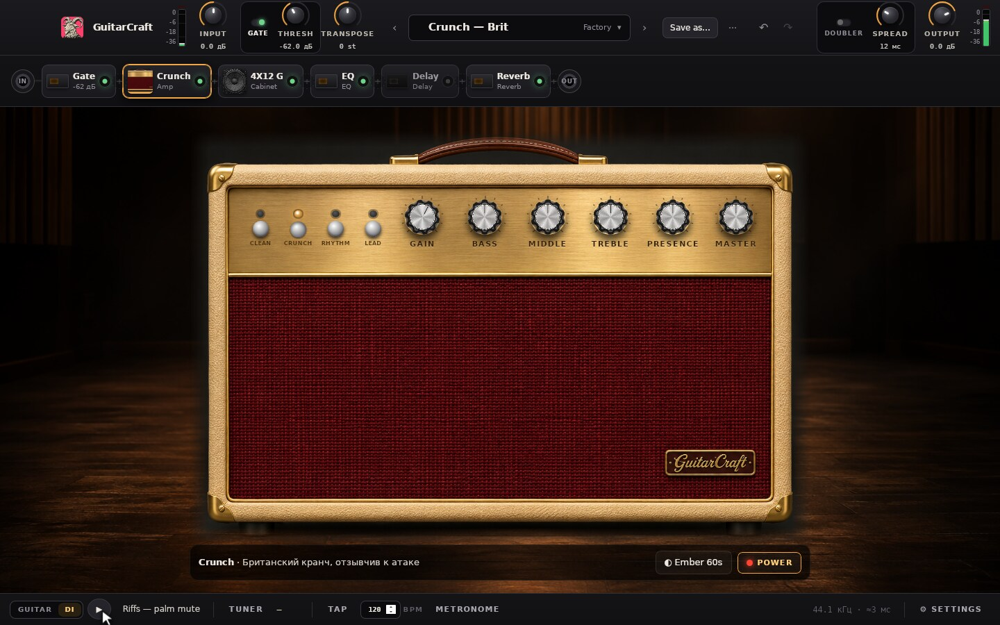
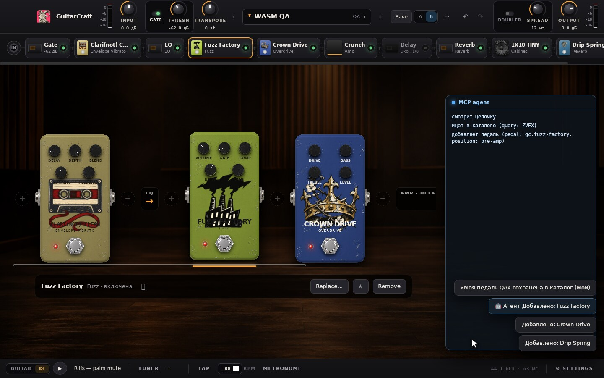

# GuitarCraft

A desktop guitar amp and pedalboard with a Rust audio engine. Plug in a guitar, build a signal chain, and save the sound as a preset.

[**Download GuitarCraft**](https://github.com/DimkaRapirka/GuitarCraft-Desktop/releases/latest) · [Features](#features) · [Get started](#get-started) · [Downloads](#downloads) · [Build from source](#build-from-source)



*The amplifier studio with the Crunch channel selected.*

<table>
  <tr>
    <td width="33%"><strong>Play through an amp</strong><br>Four amp channels, speaker cabinets, and movable microphones.</td>
    <td width="33%"><strong>Build a pedalboard</strong><br>25 built-in pedals, drag-to-reorder signal routing, and A/B auditioning.</td>
    <td width="33%"><strong>Save your rig</strong><br>Recall presets, map a MIDI controller, or control your chain over MCP.</td>
  </tr>
</table>

## Features

<table>
  <tr>
    <td width="59%"></td>
    <td width="41%"><h3>Build your signal chain</h3><p>Put a fuzz ahead of the amp or move an echo after the cabinet. Reorder blocks, bypass individual effects, and save the routing with your preset.</p></td>
  </tr>
  <tr>
    <td width="59%"></td>
    <td width="41%"><h3>Audition a pedal in context</h3><p>Search by name or effect, then hear the pedal in your rig before adding it. Fuzz Factory gives you Volume, Gate, Comp, Drive, and Stab.</p></td>
  </tr>
</table>

### Voice the amp and cabinet

Switch between Clean, Crunch, Rhythm, and Lead. Choose a speaker cabinet, blend two virtual microphones, or load an impulse response. Shape the result with rack EQ, delay, and reverb.

### Rehearse and compare

Use the tuner, tap tempo, and metronome while playing. Select a built-in DI sample and press Play to audition a rig without an interface. Presets keep your amp settings, signal chain, and effect parameters together.

### Control GuitarCraft from an agent

Enable the local MCP server in Settings to let a compatible client find pedals, change settings, and save presets. Changes appear in the app and participate in its undo history.

## Get started

1. Connect your guitar to an audio interface. In **Settings → Audio**, select the input device, channel, and output.
2. Select a factory preset, then click **+** in the chain to add a pedal.
3. Use **Save As** to keep your sound. Change the interface language under **Settings → Language**.

## Downloads

| Platform | Package | Installation |
| --- | --- | --- |
| macOS · Apple Silicon | DMG | Open the image and drag GuitarCraft to Applications. The bundle uses ad hoc signing. |
| Windows · x64 | EXE | Run the installer. It uses Microsoft WebView2. |
| Linux · x86-64 | DEB | On Ubuntu 22.04 or a compatible Debian-based system, run `sudo apt install ./GuitarCraft_0.10.0_amd64.deb`. |

Find the installers and SHA-256 checksums in the [latest release](https://github.com/DimkaRapirka/GuitarCraft-Desktop/releases/latest).

## Build from source

Use stable Rust and Node.js 22. On macOS install Xcode Command Line Tools. On Windows use the MSVC Rust toolchain, Visual Studio C++ build tools, and WebView2. Ubuntu build dependencies are `libwebkit2gtk-4.1-dev`, `libayatana-appindicator3-dev`, `librsvg2-dev`, `libxdo-dev`, and `libasound2-dev`.

```sh
rustup target add wasm32-unknown-unknown
npm ci
npm run bundle
```

The desktop shell uses Tauri and WebAssembly. The Rust audio engine processes the signal locally through Core Audio, WASAPI, or ALSA. Installers include the GuitarCraft MCP sidecar.

## Interface languages

GuitarCraft opens in English by default. Choose **English** or **Русский** under **Settings → Language**. GuitarCraft applies the selection the next time it starts. Translation catalogs live in [`crates/gc-ui/locales`](crates/gc-ui/locales).
