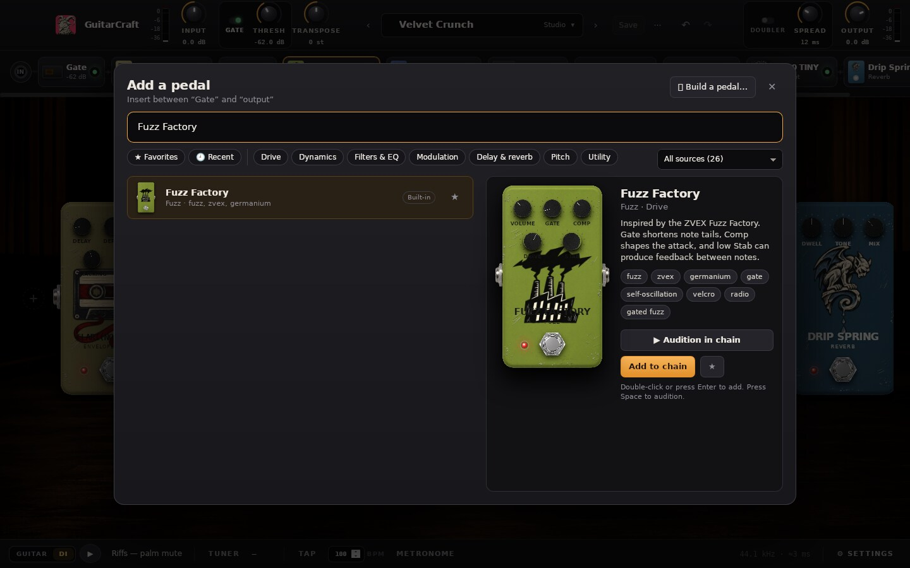
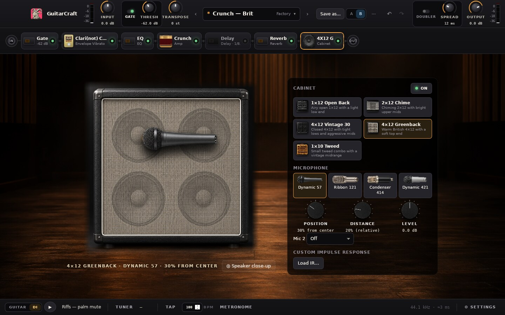

<p align="center">
  
</p>

<h1 align="center">GuitarCraft</h1>

<p align="center">
  <strong>A desktop guitar amp, cabinet simulator, and pedalboard.</strong><br>
  Plug in through an audio interface, shape your sound, and save the whole rig as a preset.
</p>

<p align="center">
  
  
  
</p>

<p align="center">
  <a href="https://github.com/DimkaRapirka/GuitarCraft-Desktop/releases/latest"><strong>Download GuitarCraft</strong></a>
  · <a href="#features">Features</a>
  · <a href="#get-started">Get started</a>
  · <a href="#downloads">Downloads</a>
  · <a href="#build-from-source">Build from source</a>
</p>

<p align="center">
  <br>
  <sub>The Crunch channel with the Ember combo skin and the full signal chain above it.</sub>
</p>

<table>
  <tr>
    <td width="25%" valign="top"><h3>Amp and cabinet</h3>Four amp channels, movable virtual microphones, and cabinet impulse responses.</td>
    <td width="25%" valign="top"><h3>Pedalboard</h3>25 built-in pedals. Place effects in front of the amp or after the cabinet.</td>
    <td width="25%" valign="top"><h3>Practice tools</h3>Tuner, metronome, tap tempo, and built-in guitar recordings for trying a rig.</td>
    <td width="25%" valign="top"><h3>Rig control</h3>Save presets, map a MIDI controller, or edit the chain with a local MCP client.</td>
  </tr>
</table>

## Features

<table>
  <tr>
    <td width="50%" valign="top">
      <br>
      <sub>Envelope vibrato, fuzz, overdrive, and spring reverb in the Velvet Crunch rig.</sub>
      <h3>Build a signal chain</h3>
      Drag effects into order, bypass individual blocks, and save their routing and settings together. Add rack EQ, delay, and reverb wherever they fit your rig.
    </td>
    <td width="50%" valign="top">
      <br>
      <sub>Fuzz Factory selected in the built-in pedal catalog.</sub>
      <h3>Audition a pedal in context</h3>
      Search by name, effect, or sound. Use Audition in Chain to hear an effect in your rig before adding it. Build custom effects from DSP blocks and save them in the same catalog.
    </td>
  </tr>
</table>

### Voice the amp and cabinet

Switch between Clean, Crunch, Rhythm, and Lead. Choose a speaker cabinet, position two virtual microphones, or load your own impulse response.

<p align="center">
  <br>
  <sub>A 4×12 Greenback cabinet with a Dynamic 57 microphone positioned 30% from the center of the speaker.</sub>
</p>

### Rehearse and compare

Tune the guitar, tap in a tempo, or lock the delay to the preset BPM. Select a built-in DI recording and press Play to try a rig without an interface. Use A/B to compare your edits with the saved sound.

### Control GuitarCraft over MCP

Enable MCP in **Settings → Agents (MCP)** to search the catalog, change effects, and save presets from a local MCP client. The setting also displays the configuration for the bundled MCP server. Edits made through MCP appear in the app’s undo history.

## Get started

1. Connect your guitar to an audio interface. Open **Settings → Audio** and select the input device, the channel you plugged into, and the output device.
2. Select a factory preset. Use **+** on the signal chain to browse or add an effect.
3. Choose **Save as…** to save a copy of the rig.

### Interface languages

GuitarCraft starts in English. Choose **English** or **Русский** under **Settings → Language**, then reopen the app to apply your selection. The interface uses translation catalogs in [`crates/gc-ui/locales`](crates/gc-ui/locales) for future languages.

## Updates

From version 0.11.0, GuitarCraft checks for a new release when it opens. Choose **Update and restart** to install it, or **Later** to keep playing. Updates are signed and verified before installation. On Linux, your system may ask for an administrator password.

If you use 0.10.1 or earlier, install the latest release once to enable in-app updates.

## Downloads

| Platform | Package | Installation |
| --- | --- | --- |
| macOS · Apple Silicon | DMG | Open the image and drag GuitarCraft to Applications. The bundle uses ad hoc signing. |
| Windows · x64 | EXE | Run the installer. GuitarCraft uses Microsoft WebView2. |
| Linux · x86-64 | DEB | Open the package with your installer or run `sudo apt install ./GuitarCraft_*_amd64.deb`. Tested on Ubuntu 22.04. |

Get the installers and SHA-256 checksums from the [latest release](https://github.com/DimkaRapirka/GuitarCraft-Desktop/releases/latest).

## Build from source

Use stable Rust and Node.js 22. On macOS, install Xcode Command Line Tools. On Windows, install the MSVC Rust toolchain, Visual Studio C++ build tools, and WebView2. On Ubuntu, install `libwebkit2gtk-4.1-dev`, `libayatana-appindicator3-dev`, `librsvg2-dev`, `libxdo-dev`, and `libasound2-dev`.

```sh
rustup target add wasm32-unknown-unknown
npm ci
npm run bundle
```

GuitarCraft uses Tauri for its desktop shell and Rust compiled to WebAssembly for its interface. The Rust audio engine processes the signal locally through Core Audio, WASAPI, or ALSA. Each installer includes the GuitarCraft MCP sidecar.

### Prepare an update release

Collect the matching Windows EXE, Linux DEB and macOS DMG in a release directory on the signing Mac. With the matching macOS app built and `TAURI_SIGNING_PRIVATE_KEY_PATH` set to the release key, run `node tools/sign-updates.mjs <release-directory>`. Upload the installers, macOS app archive and generated `latest.json` to the same draft release before publishing it as the latest stable version.
